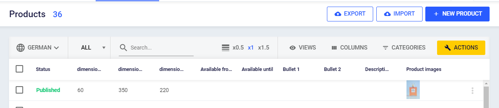

Most tasks related to product editing, import and export start at the product list page.

## Page toolbar

Element | Description
--- | ---
Number of products | The number of products the list shows, with the search and filter applied. It is shown beside the **Products** heading.
Export | Opens **Export products**; see [Exporting products](#exporting-products).
Import | Opens a menu: **Products** imports products from a file, **Products to delete** deletes the products a file lists. See [Import or delete products from a file](/en/import/import-products.html); for files that arrive regularly, use a [data source](/en/import/data-sources.html) instead.
New product | Create a new product.

## List toolbar

Element | Description
--- | ---
Actions | The button with the list icon at the start of the toolbar. It opens the actions for the rows you selected; see [Acting on a selection](#acting-on-a-selection).
Search | Search in products; see below for details.
List product variants | Shows one row for each product variant instead of one row for each product. Click it again to go back to product rows.
Row height | Set the height of the list rows: **x0.5**, **x1** or **x1.5**.
Views | Save and restore list views; see below for details.
Columns | Opens **Manage columns**, where you choose which attributes the list shows as columns.
Categories | Filter product list by category.
Filter | Filter the list by your custom attributes and the product's other fields, whether or not they are shown as columns; see below.
Language | The language picker: choose your [working language](/en/concepts/languages.html#working-language). It decides which value of a translatable attribute you see and which label each attribute is shown by. It does not change the language of the app itself.

## Selecting products

Select rows with the checkbox at the start of each row, then choose an action from the **Actions** button.

- **One row at a time:** tick the checkbox of each row you want.
- **Select all:** tick the checkbox in the header of that column. This selects every row the list matches with its search and filter applied, including rows not yet loaded on screen. To leave some out, untick them afterwards.
- **To clear the selection,** click the header checkbox again while any row is selected.

**With List product variants on, the rows are product variants, and so is the selection.** Select all then selects every product variant the list shows, and an action applies to those product variants rather than to the whole products they belong to.

### Acting on a selection

The **Actions** button opens a menu of what you can do with the selected rows. It shows only the actions your permissions allow.

Action | What it does
--- | ---
Publish | Publishes the selected products or product variants.
Unpublish | Unpublishes the selected products or product variants.
Delete | Deletes the selected products or product variants.
Change product type | Gives the selected products another [product type](/en/concepts/product-types.html), with one of its variant configurations.
Bulk edit | Opens **Bulk edit products** — or **Bulk edit product variants** while **List product variants** is on — to change attribute values on every selected row at once.

**A product type applies to the whole product.** So after a select all with **List product variants** on, **Change product type** cannot be chosen, and the menu says: *Turn off List product variants and select products first. A product type applies to the whole product.* Turn **List product variants** off, select the products, and choose **Change product type** again.

## Searching and filtering products

Three tools narrow the list, and they work together: the search box finds products by a value you type, **Filter** in the toolbar combines conditions on many fields, and the filter in a column header filters on that one column.

### Search text box

This textbox is to search for products by their name, sku or gtin. First, select which attributes to search using the dropdown left beside the search input. 

The search field allows you to search for multiple values, e.g., multiple SKUs. To search for multiple values

* Type all values separated by a semicolon (";") or
* Copy and paste comma, tab or line separated lists or
* Copy and past columns or rows from Excel documents

### Filter

**Filter** in the list toolbar builds a filter from the fields a product has: your own custom attributes, and the fields the platform keeps for every product, such as when it was created, its product type, its categories and its status.

1. Click **Filter**.
2. Choose a field. **Search fields** finds one by name.
3. Choose an operator and enter or pick a value.
4. To add another condition, click **Add condition**. To combine some conditions separately from the rest, click **Add group**.

A group matches when **all** of its conditions match (AND) or when **at least one** does (OR); to switch, click the badge at the top of the group that reads **AND** or **OR**. The list updates as soon as every condition is complete, and the **Filter** button is highlighted while a filter is applied. A filter is part of the list settings a [product view](#product-views) saves.

**A filter reaches a field whether or not its column is shown.** To find products created last week, filter on **Created on**; there is no need to add a column for it first.

The field list is grouped. Besides **Attributes**, which holds your custom attributes, it offers these fields:

| Group | Field | What it filters on |
| --- | --- | --- |
| Identifiers | Variant ID | The ID of one product variant. |
| Identifiers | Product ID | The ID of a product, which matches all its product variants. |
| Dates | Created on | When the product was created. |
| Dates | Last updated | When the product was last changed. |
| Classification | Product type | The product's [product type](/en/concepts/product-types.html), picked from a list. |
| Classification | Categories | One [category](/en/concepts/categories.html), picked from a list. **linked directly to** finds products assigned to that category itself; **linked to, including subcategories** also finds products in any category below it. |
| Classification | Status | **Draft**, **Published**, **Modified** or **Partially published** — the same four values as the filter in the **Status** column header. |
| Product variants | Variant configuration ID | The product's variant configuration: which attributes split it into product variants, level by level (for example color, then size), picked from a list. Every product uses exactly one of its product type's variant configurations; see [product variants](/en/concepts/product-variants.html). |

A **Variant ID** or **Product ID** is entered in full, in the form `3f2b91c4-7a10-4d8e-9c55-0b1e6a2d8f77`.

Prices and delivery windows cannot be filtered on.

### Column header filters

Move the mouse pointer over any column header and click the filter icon. Now define your filter inside of the dropdown. A column header filter applies to that one column; to combine conditions, or to filter on a field that is not shown as a column, use **Filter** instead.

## Product Views

Product views store all list settings so you can quickly restore views. This includes

* Visible columns
* List sorting
* List filters

## Exporting products

**Export** in the page toolbar opens **Export products**. On its **Products** tab you choose what goes into the file:

Option | Choices
--- | ---
Columns | **All product attributes**, or **Visible product attributes (n)** — only the attributes shown as columns in the list.
Products | **All products**; **Filtered products (n)** — the products the list matches with its search and filter applied; or **Selected products (n)** — the rows you selected. While **List product variants** is on, the last option reads **Selected product variants (n)**, and the export holds the product variants you selected.
Data | **Published data** — only published products, with the values that are published; or **Latest saved data** — every product with its saved changes, including those that aren't published yet.
Format | **Excel workbook** or **CSV file**.

To export the asset files your products use, select **Include asset files** on the **Assets** tab. The export is then a ZIP file with every asset the exported products use; otherwise each asset is exported as the URL it can be downloaded from.

Click **Export** to start it. The export runs in the background.
